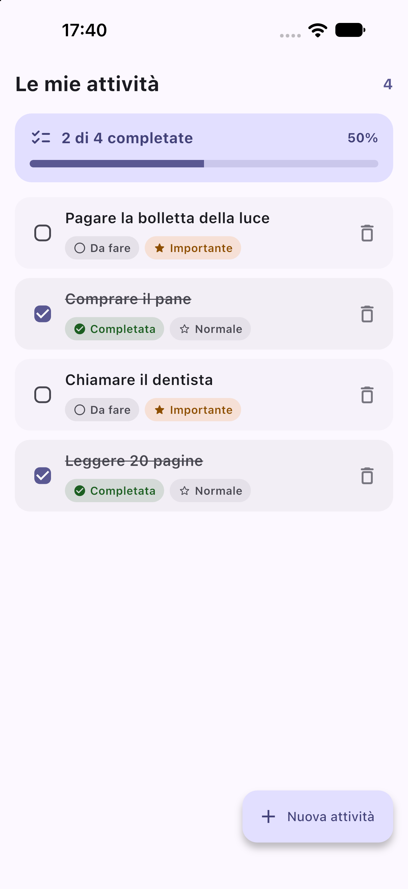
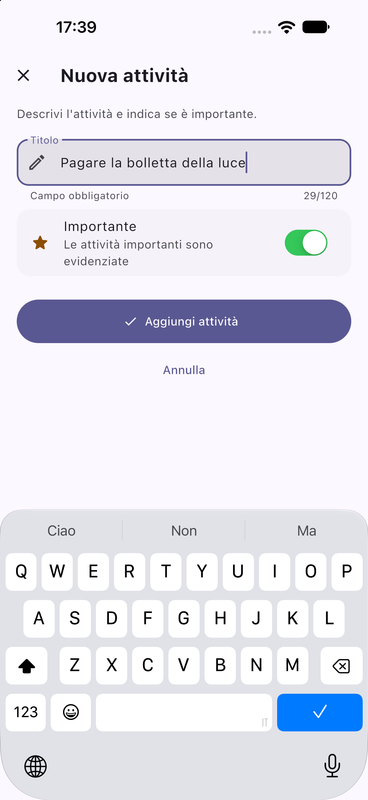
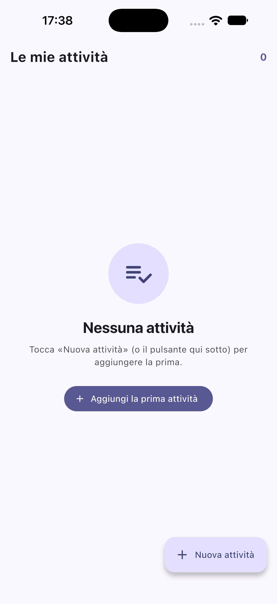
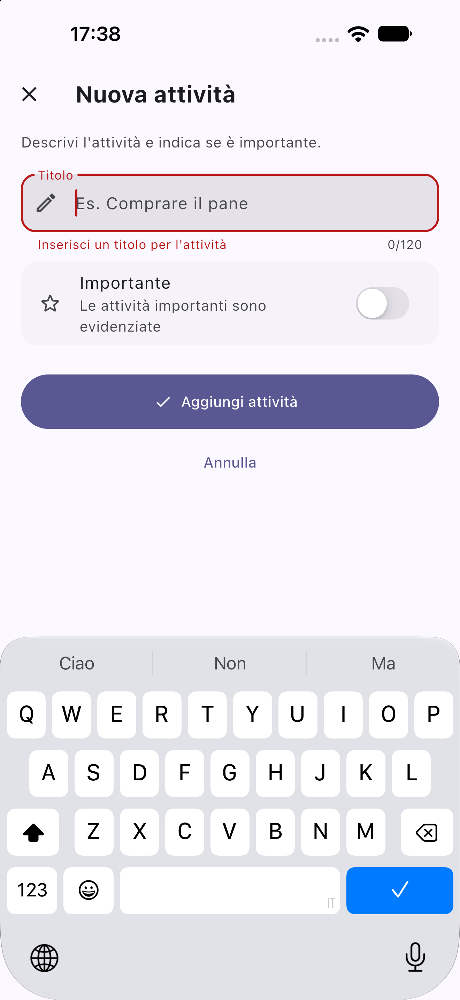
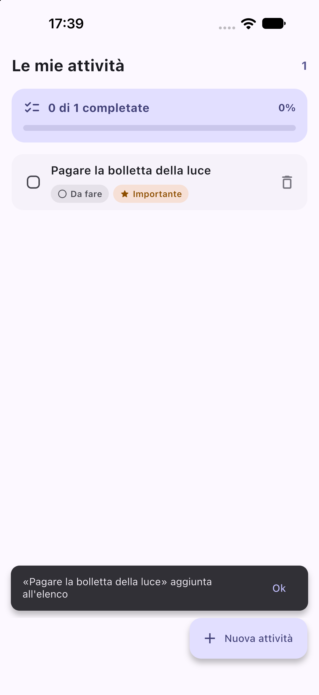
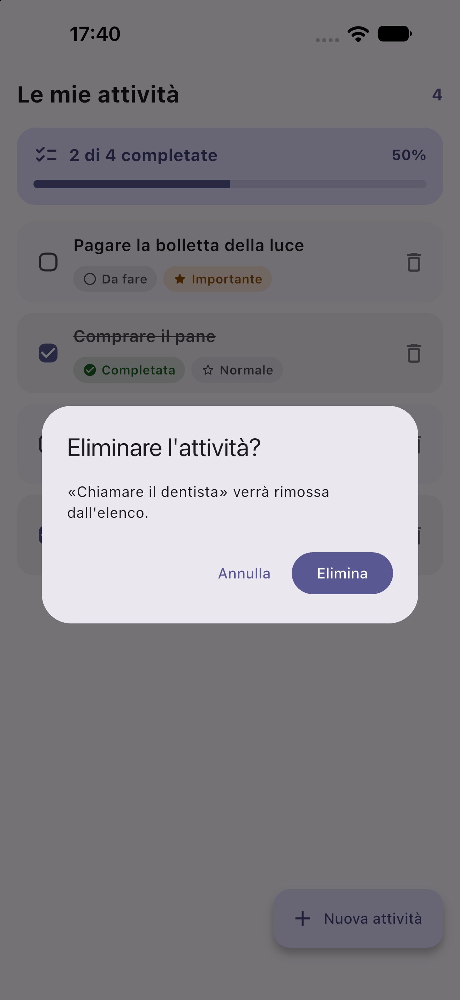

# Le mie attività — Todo List in Flutter

> Repository pubblica: <https://github.com/Dadox01/todo-list-flutter>

App Flutter (Material 3) per gestire una lista di attività. Esercitazione sui
concetti di base: composizione dei widget, gestione dello stato, input utente e
navigazione tra schermate.

## Requisiti

- Flutter 3.47 (canale stable) / Dart 3.13
- Nessuna dipendenza esterna: solo SDK Flutter

## Avvio

```bash
flutter pub get
flutter run            # sceglie il dispositivo collegato
flutter run -d iphone  # emulatore iOS, se disponibile
flutter test           # 15 test: 6 unitari + 9 di scenario
```

## Dominio

Un'unica entità, `Task`, in `lib/models/task.dart`:

| Campo         | Tipo         | Regola                           |
| ------------- | ------------ | -------------------------------- |
| `id`          | `int`        | assegnato dallo store            |
| `title`       | `String`     | obbligatorio (non vuoto)         |
| `status`      | `TaskStatus` | `todo` \| `done`; nuovo = `todo` |
| `isImportant` | `bool`       | default `false`                  |

`Task` è immutabile: si aggiorna con `copyWith`, così il ridisegno della UI è
prevedibile. `TaskStatus` è un `enum` con etichetta leggibile ("Da fare" /
"Completata").

## Architettura

```
lib/
├── main.dart                  # radice: tema + MaterialApp
├── models/task.dart           # Task, TaskStatus, TaskDraft
├── state/tasks_store.dart     # ChangeNotifier: unica fonte di verità
├── screens/
│   ├── tasks_screen.dart      # elenco + azioni (R2, R3, R4)
│   └── new_task_screen.dart   # form di creazione (R1)
├── widgets/
│   ├── task_tile.dart         # riga: titolo, stato, importanza, elimina
│   └── completion_summary.dart# conteggio completate + stato vuoto
└── theme/app_theme.dart       # tema chiaro/scuro da un colore seme
```

Scelte principali:

- **Stato**: `TasksStore extends ChangeNotifier` creato in `main` e passato alla
  schermata. La lista si aggiorna con `ListenableBuilder`, senza pacchetti
  esterni (`provider`, `riverpod`, ...): la gestione dello stato resta visibile.
- **Separazione**: i widget di presentazione (`TaskTile`) non conoscono lo
  store; ricevono dati e callback. Le mutazioni passano solo dai metodi dello
  store, che espone la lista come vista non modificabile.
- **Navigazione**: `Navigator.push` verso il form, che restituisce una
  `TaskDraft` (o `null` se l'utente rinuncia). Il form non modifica l'elenco:
  lo fa la schermata chiamante, che mostra anche lo `SnackBar` di conferma.
- **Validazione**: `Form` + `TextFormField` con `autovalidateMode` disattivato
  fino al primo tentativo di conferma; da lì in poi l'errore appare/sparisce
  mentre si digita. Il titolo viene anche ripulito dagli spazi (`trim`).
- **Eliminazione**: sempre con `AlertDialog` di conferma; "Annulla" non tocca
  nulla e non mostra messaggi.

Lo stato è in memoria: chiudendo l'app l'elenco riparte vuoto. La persistenza
non è tra i requisiti della traccia.

## Requisiti e scenari coperti

| Requisito           | Dove                                                     |
| ------------------- | -------------------------------------------------------- |
| R1 Aggiungere       | FAB "Nuova attività" → `NewTaskScreen`                   |
| R2 Consultare       | lista con titolo, stato, importanza, "X di Y completate" |
| R3 Aggiornare stato | tocco sulla riga o sulla casella → `toggleStatus`        |
| R4 Eliminare        | icona cestino → dialogo di conferma → `remove`           |

Copertura di test (`test/`):

- S1 conferma → aggiunta + SnackBar; titolo mancante → errore e nessuna
  creazione, errore che sparisce correggendo; rinuncia (back di sistema) →
  nessuna modifica e nessun messaggio; default non importante.
- S2 elenco con stato/importanza/conteggio; stato vuoto con indicazione.
- S3 toggle in entrambe le direzioni con conteggio aggiornato.
- S4 eliminazione confermata e variante di rinuncia.

## Screenshot

Catturati dall'app in esecuzione sull'emulatore iOS (iPhone 18 Pro Max, iOS
27.0), guidata dal test end-to-end `integration_test/screenshot_test.dart`.

| Elenco (S2, S3)                            | Nuova attività (S1)                                | Stato vuoto (S2)                        |
| ------------------------------------------ | -------------------------------------------------- | --------------------------------------- |
|   |  |  |

| Errore titolo mancante (S1)                            | Messaggio di conferma (S1)                                        | Conferma eliminazione (S4)                                        |
| ------------------------------------------------------ | ----------------------------------------------------------------- | ----------------------------------------------------------------- |
|        |            |          |

## Verifica

```bash
flutter analyze                                  # 0 issue
flutter test                                     # 15 test (6 unitari + 9 di scenario)
flutter test integration_test -d <device-id>     # percorso E2E sull'emulatore
```
